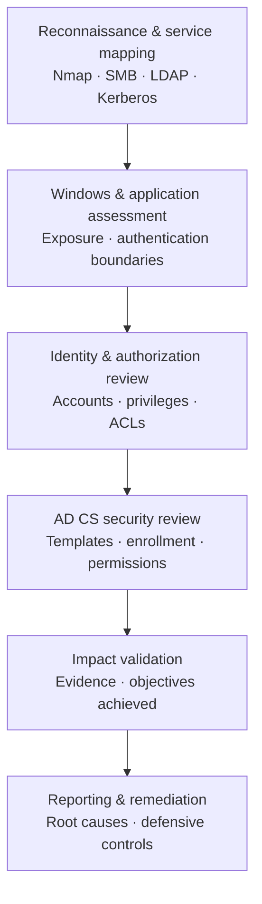

> **Platform:** Hack The Box · **Machine:** DanglingTree · **Difficulty:** Medium · **Environment:** Windows / Active Directory · **Status:** Completed (user and root objectives).

## Executive summary

**DanglingTree** is an authorized Hack The Box penetration-testing lab built around a Windows and Active Directory environment. I completed both objectives and documented how seemingly separate weaknesses in service exposure, application security, credential handling and identity permissions can contribute to a larger security impact.

The main value of this exercise was **attack-path analysis**: connecting technical findings across layers instead of treating each exposed service or misconfiguration as an isolated issue.

**Scope note:** This is a personal lab exercise, **not a client engagement**. While the machine is active, this public article is a detailed **non-spoiler technical case study**, not a step-by-step solution.

## 1. Environment and assessment objectives

The lab combined Windows network services, an internal application and Active Directory identity infrastructure. My objectives were to:

1. Map the reachable services and identify meaningful entry points.
2. Assess authentication boundaries and exposure of sensitive information.
3. Understand account privileges and delegated Active Directory permissions.
4. Review certificate-based authentication and AD CS security controls.
5. Validate the security impact and document defensive recommendations.

The assessment was conducted within the authorized HTB environment.

## 2. Assessment workflow

The following diagram represents **the audit methodology**, not the machine-specific exploitation chain.

### Phase A — Reconnaissance and service mapping

I started by enumerating network-facing services and identifying which were relevant to a Windows domain environment. The goal was not to run every possible tool, but to connect observations to specific questions:

- Which services expose domain or host information?
- Which authentication mechanisms are in use?
- Where are the boundaries between externally reachable services and internal resources?
- Which observations require manual validation before being reported?

**Tools and protocols:** Nmap, SMB, LDAP and Kerberos.

### Phase B — Windows and application security assessment

I investigated the security of Windows-facing management functionality and an internal application encountered during the lab. The key question was whether the permissions granted at the application layer were consistent with the privileges available in the underlying Windows environment.

This stage reinforced an important principle: **application access and operating-system access must be assessed separately**, even when the application runs inside a trusted network.

### Phase C — Credentials, accounts and Active Directory permissions

After establishing the relevant identity context, I reviewed how credentials and permissions were managed. The work involved reasoning about:

- Sensitive application and backup material.
- Windows-protected credential data and DPAPI concepts.
- Account relationships, group membership and delegated rights.
- Whether an apparently limited account could influence a more privileged security principal.

I treated access-control relationships as evidence to be verified, rather than assuming that a particular permission automatically meant full compromise.

**Tools and concepts:** NetExec, Impacket, LDAP, DPAPI and Active Directory ACLs.

### Phase D — AD CS and certificate-based authentication

The later analysis focused on Active Directory Certificate Services. I examined how certificate templates, their directory permissions and enrollment policies can affect the effective authentication privileges of domain users.

This required distinguishing **certificate-template configuration** from **the permissions governing who can change or use that configuration**. The lab demonstrated why AD CS should be included in an Active Directory security review, not considered an isolated PKI component.

**Tools and concepts:** Certipy, Kerberos, AD CS, certificate templates and PKINIT.

### Phase E — Validation and reporting

I verified the lab objectives and documented the security impact of the observed weaknesses. The complete private research notes include the technical decision points and validation steps; this public version deliberately omits the target-specific sequence, credentials, flags and commands that would reveal the solution.

## 3. Technical findings and defensive lessons

| Security area | Generalized observation | Recommended control |
| --- | --- | --- |
| Network exposure | Accessible Windows services can reveal valuable environment context. | Restrict unnecessary access and review exposed management interfaces. |
| Application boundaries | A weakness in an internal application can have consequences beyond the application itself. | Patch vulnerable software, segment services and limit service-account privileges. |
| Credential protection | Sensitive files and backups may expand the reach of a compromised identity. | Apply least privilege, secure backups and rotate exposed secrets. |
| AD permissions | Delegated rights can create unexpected privilege relationships. | Periodically audit ACLs, group membership and sensitive delegation. |
| AD CS | Template settings and permissions can affect domain authentication security. | Audit certificate templates, enrollment rights and changes to AD CS configuration. |
| Detection | A single log source rarely captures a multi-stage identity attack. | Correlate Windows, application, Kerberos and certificate-service events. |

These are **defensive takeaways**, not claims that a particular production system was assessed.

## 4. Tools and competencies demonstrated

- **Reconnaissance:** Nmap, SMB and LDAP enumeration, service interpretation.
- **Windows / Active Directory:** authentication concepts, identity relationships, ACL and delegated-permission analysis.
- **Credential security:** DPAPI concepts, sensitive-material exposure and access-boundary reasoning.
- **PKI / AD CS:** certificate-template review, enrollment security and Kerberos authentication.
- **Reporting:** documenting evidence, separating verified observations from hypotheses, and mapping findings to remediation.

## 5. Outcome

- **User objective:** completed.
- **Root objective:** completed.
- **Technical scope covered:** Windows services, application security, credential handling, Active Directory permissions and AD CS.
- **Deliverable:** an internal technical write-up plus this public, recruiter-friendly case study.

This project demonstrates a **completed, authorized Windows/AD pentest lab**. It should not be confused with a professional penetration-testing assignment.

## 6. Full write-up availability

The detailed, machine-specific write-up is retained separately. **It will not be linked or reproduced here while the machine is active**, because it contains solution details.

For a recruiter reviewing my CV, this page documents the scope, methodology, tools, validated outcome and security lessons without disclosing the lab solution.
