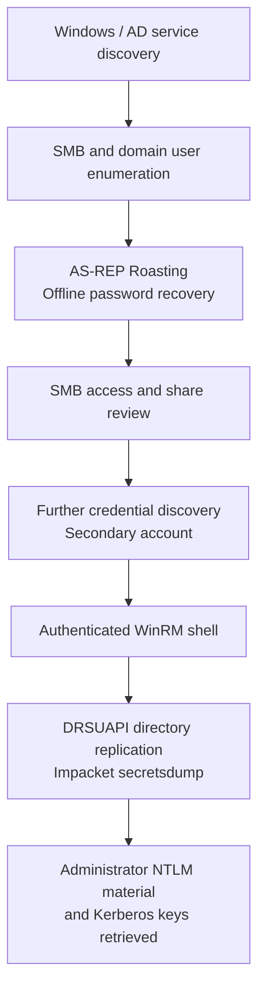

> **Platform:** TryHackMe · **Lab:** VulnNet-RST · **Environment:** Windows Server / Active Directory · **Work performed:** April 2026 · **Type:** Authorized training lab

## Executive summary

This case study documents my hands-on assessment of the **VulnNet-RST Active Directory environment**. The exercise connected several stages of an internal Windows domain attack: discovering domain users, identifying an account exposed to AS-REP Roasting, recovering a password offline, assessing SMB access, obtaining an authorized lab shell over WinRM, and validating the impact of directory replication rights through **DRSUAPI-based credential extraction**.

The strongest verified result was the successful retrieval of **Administrator NTLM material and Kerberos keys** using Impacket's `secretsdump` functionality. This is evidence of a serious Active Directory privilege boundary failure within the lab. It is **not** a claim of a production engagement, and the records available to me do **not** establish that I captured a final room flag.

This article is an **evidence-based technical case study** rather than a fabricated command-by-command transcript. Passwords, hashes, flags and target-specific credentials are deliberately omitted.

## 1. Scope and objectives

The target was a Windows Server domain environment with common enterprise authentication and file-sharing services. The practical objectives were to:

1. Discover exposed Windows and Active Directory services.
2. Enumerate domain identities and accessible SMB resources.
3. Assess Kerberos pre-authentication exposure and password strength.
4. Test whether recovered credentials enabled remote management access.
5. Determine the effective impact of privileged directory permissions.
6. Document attack-path causes and defensive measures.

All actions were performed within the training environment.

## 2. Validated attack-chain overview

The following diagram summarizes the **observed phases**. It intentionally does not invent the exact intermediate mechanism by which the second account's credentials were discovered.

**Important distinction:** the first recovered account did not immediately provide WinRM access. The later WinRM shell used a different account. The exact source of that second account's credentials is not reconstructed here because the retained evidence is insufficient to describe it reliably.

## 3. Reconnaissance and SMB enumeration

The initial work focused on the domain's Windows services and the information available through SMB and account enumeration. Guest/anonymous access was useful for establishing the environment's structure, and RID-based enumeration helped identify candidate domain accounts.

With a recovered domain user's credentials, I was able to authenticate to SMB and review accessible shares. The documented environment exposed standard domain resources such as **NETLOGON** and **SYSVOL**, along with additional business-oriented shares.

This stage illustrated two points:

- An account with limited permissions can still reveal information that is useful for further assessment.
- A readable share is not automatically a vulnerability; the security impact depends on **which information is exposed** and whether it enables a meaningful next step.

**Relevant tools/protocols:** SMB, NetExec, smbclient, Windows domain account enumeration.

## 4. Kerberos exposure: AS-REP Roasting

The account-enumeration stage identified an identity susceptible to **AS-REP Roasting**. When Kerberos pre-authentication is not required for an account, an attacker may request authentication material that can be tested offline against candidate passwords.

In this lab, the AS-REP material was successfully cracked and a working domain password was recovered. I then validated the account's access, including SMB authentication.

The first attempt to use those credentials for **WinRM** did **not** grant remote shell access. This was an important finding: **valid domain credentials do not imply permission to log in remotely**.

### Defensive interpretation

- Require Kerberos pre-authentication for accounts unless there is a justified exception.
- Enforce strong, unique passwords and review service-account configurations.
- Monitor anomalous Kerberos authentication requests, while correlating them with account configuration and other events.
- Restrict remote management rights independently of basic domain authentication.

## 5. WinRM access and privilege assessment

After further investigation, a **second domain account** was used to obtain an authenticated Windows shell through WinRM. This allowed the lab's domain permission model to be assessed from an authenticated context.

I did not treat shell access itself as proof of domain administration. Instead, the next step was to verify the effective directory permissions by testing a concrete capability.

**Relevant tools/protocols:** Evil-WinRM, Windows authentication, Active Directory permission analysis.

## 6. DRSUAPI credential extraction: verified impact

The decisive result came from an Impacket `secretsdump` operation targeting the **Administrator** account via **DRSUAPI**. The recorded command completed successfully and returned:

- NTLM credential material for the domain Administrator account.
- Associated Kerberos AES key material.

This demonstrates the impact of directory replication privileges: an identity able to perform sensitive replication operations may extract password-related material from Active Directory without needing interactive login as the affected user.

The key technical lesson is to distinguish **being able to authenticate**, **having remote shell rights**, and **possessing directory replication privileges**. These are separate security boundaries, and the last can be particularly sensitive.

### Defensive interpretation

| Area | Risk illustrated | Recommended control |
| --- | --- | --- |
| Kerberos accounts | Offline password attacks against accounts without pre-authentication | Audit pre-authentication settings and password quality |
| SMB shares | Information exposure to low-privilege identities | Apply least privilege and review sensitive file access |
| Remote management | Unauthorized interactive access when permissions are excessive | Restrict WinRM access to approved administrative identities |
| AD replication | Extraction of high-value domain credentials | Audit replication rights and privileged group memberships |
| Detection | Multi-stage attacks may appear as unrelated events | Correlate account enumeration, Kerberos requests, remote logons and replication activity |

## 7. Evidence, limitations and outcome

**Confirmed from retained lab evidence:**

- Domain account discovery and an AS-REP Roasting/password recovery workflow.
- Successful SMB authentication and access to several domain shares.
- An initial WinRM access denial with the first recovered account.
- Subsequent WinRM shell access using another account.
- Successful DRSUAPI extraction of Administrator NTLM material and Kerberos keys.

**Not claimed:** a verified final flag submission, a production-system compromise, or an exact intermediate credential-discovery technique where the evidence is incomplete.

## 8. What this project demonstrates

This lab gave me practical experience in **Windows/AD enumeration, Kerberos security, SMB access assessment, credential validation, WinRM access, directory replication risks and evidence-based reporting**.

For an offensive-security or Red Team internship, the value is not merely running tools: it is following the relationship between **identity configuration, authentication boundaries, delegated rights and the actual security impact**.

*Authorized lab exercise. No passwords, hashes or target-specific secrets are published in this case study.*
