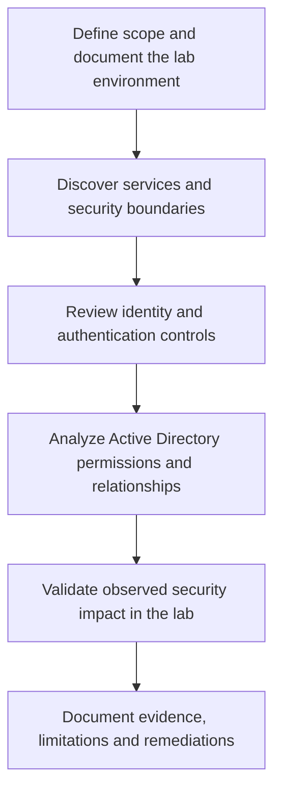

> **Platform:** TryHackMe · **Room:** [Reset](https://tryhackme.com/room/resetui) · **Difficulty:** Hard · **Completed:** October 30, 2026 · **Environment:** Windows / Active Directory · **Type:** Authorized training lab

## Executive summary

I completed **Reset**, an Active Directory lab rated **Hard** on TryHackMe, on **October 30, 2026**. Both lab objectives were reached.

This case study explains **how I approached the assessment**, what security ideas I practiced, and what defenders can learn from the exercise. It intentionally excludes the machine-specific exploitation chain, account names, answers, credentials, flags and instructions that would disclose the room's solution while it is active.

The aspect I found most interesting was not the difficulty label. Once the relevant permission relationships became clear, the investigation was much more straightforward than I had expected. I even described it afterward as *the easiest Active Directory lab I had done*—a personal reaction, not a claim about the room's objective difficulty.

## Scope and methodology

The assessment took place only inside the lab environment assigned by TryHackMe. My goal was to work as I would in an authorized internal security assessment: identify exposure, validate the security impact of permissions, record evidence, and connect technical findings to actionable remediation.

The public workflow below is **generic methodology**, not the room's attack path:

### 1. Service and environment assessment

I began by understanding the Windows domain context and the services available to a tester. This involved relating observations to specific attack-surface questions rather than interpreting an open port as a vulnerability by itself.

For any Windows domain assessment, the important distinctions are:

- **Reachability:** a service can be contacted.
- **Authentication:** an identity can prove who it is.
- **Authorization:** that identity can perform a particular action.
- **Security impact:** the action can influence something sensitive.

Those boundaries must be validated independently.

### 2. Identity and authentication review

The lab provided practice in reasoning about domain identities and authentication security. My notes and terminal history covered Windows authentication, Kerberos concepts and credential-validation decisions.

The general lesson is that recovering a working credential does **not** automatically grant remote shell access or administrative rights. An accurate report separates those outcomes and documents which access boundary was actually crossed.

### 3. Active Directory permission analysis

The most useful part of the exercise was interpreting **Active Directory object permissions** and the relationships between identities.

BloodHound is particularly valuable as an analytical aid: it can display paths worth investigating, but a graph edge is an **assessment lead**, not a substitute for confirming effective privileges.

When reviewing an AD permission finding, I ask:

| Question | Why it matters |
| --- | --- |
| Which principal holds the right? | It identifies who can initiate the action. |
| Which object does the right affect? | The target object's role determines impact. |
| Is the permission direct or inherited? | The source of exposure affects remediation. |
| Can the principal actually exercise the right? | A theoretical graph relationship needs validation. |
| Does the action change access to higher-value resources? | This separates a configuration observation from a material security risk. |

No user-to-user relationship, exact ACL chain or actionable room-specific path is disclosed in this public article.

### 4. Kerberos and delegated access

The exercise reinforced the importance of reviewing **Kerberos delegation** as part of an Active Directory audit.

In enterprise environments, delegation can allow an application or service to act on behalf of users for specific services. Its security depends on the chosen principals, allowed services, authentication protections and the privileges of accounts that control the configuration.

A secure assessment considers not just whether delegation exists, but whether it is **strictly necessary, appropriately scoped and monitored**.

### 5. Evidence-based validation

During the lab, I distinguished between a hypothesis identified during enumeration, an access test that failed, and an outcome that I could verify. That distinction matters in professional penetration-testing reports: the severity assigned to a finding must match its observed impact.

I reached both of the room's objectives. The evidence and the exact route are deliberately withheld from this public version.

## Technical competencies exercised

| Area | Competency demonstrated |
| --- | --- |
| Network assessment | Service identification and Windows-domain attack-surface reasoning |
| Authentication | Understanding Kerberos flows and why successful authentication differs from authorization |
| Active Directory | ACL interpretation, delegated permissions and potential privilege relationships |
| Attack-path analysis | Using BloodHound to prioritize hypotheses while requiring validation |
| Windows access | Separating remote-management rights, service access and administrative privileges |
| Reporting | Recording evidence, distinguishing observations from assumptions, proposing remediation |

**Context:** this was a completed personal training lab, **not a production pentest or a client engagement**.

## Defender-oriented takeaways

The points below apply broadly to Active Directory environments and are **not a disclosure of Reset's unique solution**.

### Reduce unnecessary information exposure

Review what unauthenticated users and ordinary domain accounts can access. Business documents, configuration exports and scripts should not reveal secrets or information that permits unexpected access.

### Harden identity configuration

Audit Kerberos account settings, enforce strong passwords, restrict interactive logon paths and review service accounts regularly. Valid credentials are only one part of a defense-in-depth model.

### Review delegated object permissions

Excessive rights such as broad object control, password-reset authority or permissions to change ACLs can create unintended relationships between accounts. Evaluate both direct assignments and the **transitive effect** of multiple delegated rights.

### Constrain and monitor delegation

Limit Kerberos delegation to required services and identities. Review changes to sensitive delegation settings and treat them as part of privileged-identity governance.

### Detect combinations of weak signals

A useful investigation often involves correlating authentication activity, identity changes and privileged service access. Isolated security events can look routine; their **sequence and relationship** can be far more informative.

## Lessons learned

Three lessons stood out to me.

**First, an intimidating difficulty label does not replace systematic enumeration.** The environment became easier to reason about after mapping the relationships that mattered.

**Second, permissions are as important as vulnerabilities.** A security audit should investigate what an account can influence, not only which software versions appear vulnerable.

**Third, a write-up must be honest about evidence.** A successful outcome is important, but a defensible report explains which steps were observed, what was inferred and where the evidence has limits.

## Outcome and publication policy

- **Room:** Reset (TryHackMe Hard).
- **Completed:** October 30, 2026.
- **Objectives:** both completed.
- **Technical focus:** Windows/AD assessment, permissions, authentication and delegated-access security.
- **Public deliverable:** this spoiler-free, recruiter-friendly technical case study.

I am not publishing the specific credential path, commands that solve the room, flags or complete attack chain. TryHackMe's [Acceptable Use Policy](https://tryhackme.com/legal/acceptable-use-policy) protects active challenge solutions; detailed write-ups are permitted only for content explicitly designated as retired, subject to their guidance.

For a recruiter, the purpose of this page is to show **methodology, technical judgment and defensive understanding** without reducing the value of the challenge for other learners.
