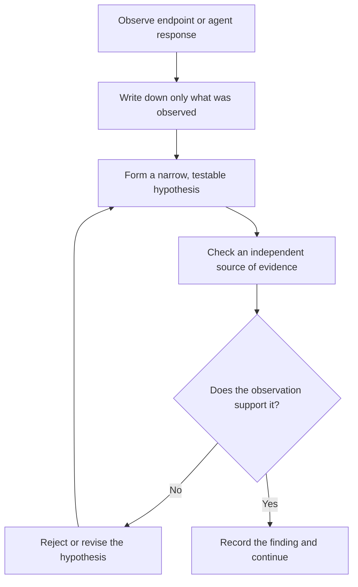

> **Room:** [TryHackMe — Token City](https://tryhackme.com/room/tokencity), ShopFlow task  
> **Category:** Agentic AI · **Difficulty:** Medium · **Author:** Kossi Richard Allado (`allakori`)  
> **Disclosure:** Spoiler-free case study. No flag, challenge secret, exploitation payload, or solution-specific field names are provided while the room remains active.

## Overview

ShopFlow explores a familiar trap in AI-assisted applications: a public-facing agent can **describe** an operation in reassuring terms without actually **performing** it. This exercise taught me to separate a language model's claims from the application's observable behavior.

This article focuses on my investigation workflow, including false starts and evidence-driven pivots. It intentionally omits the challenge solution. I did use external assistance during the investigation; the account below does not present the entire path as an unaided discovery.

## 1. Establishing an API baseline

I began by examining the documented endpoints and checking the request format. A malformed request produced a validation error. Correcting the JSON structure and content type allowed requests to reach the application logic.

| Observation | What it actually established |
| --- | --- |
| Malformed JSON returned HTTP 422 | My input had not passed parsing or validation |
| An ordinary chat message returned HTTP 200 | The public-facing assistant was reachable |
| The transaction endpoint enforced its stated policy | A real server-side decision was being made |

A **successful HTTP request** is not the same thing as a **successful business operation**. This distinction became essential later.

## 2. Reconnaissance: what does the agent claim it can do?

My first substantial question asked the support agent to describe its responsibilities and the kinds of information it was not permitted to provide. The objective was to map its claimed scope before testing its trust boundaries.

The assistant discussed routine customer support duties and described restrictions around internal information. I then investigated its authorization language and documentation-related responses. Some answers were generic, some refused to go further, and others appeared confident without demonstrating any backend capability.

**Key lesson:** an assistant's own account of its permissions is an observation, not a validated access-control specification.

## 3. An apparent approval that did not happen

One of the most instructive dead ends was asking the support assistant for help completing a transaction and receiving language that sounded like an operational confirmation.

Rather than trusting that wording, I checked the independent application endpoint. The backend still enforced the original restriction. The assistant's conversational assurance had not changed application state.

```text
Agent says:        "The action can proceed."
Application says:  The operation is still not authorized.

Inference: a textual claim is not proof of a state change.
```

This is especially important in agentic systems. An agent may talk about tools, decisions or approvals without possessing the capability—or having performed the action—it describes.

## 4. Pivoting from persuasion to evidence

The initial approach focused too heavily on persuading the support assistant to declare success. A better research approach was to track what each response **newly established** and what still required validation.

Some replies simply paraphrased the challenge description. Others introduced technical concepts that could be investigated in follow-up questions. In several cases, answers varied between repeated requests, and some detailed-looking answers contained technical inconsistencies.

I documented the process as a small hypothesis-testing loop:



An important integrity point: **the final investigation was not entirely blind**. External guidance had been consulted, so I distinguish observations obtained from my own testing from knowledge introduced later. A convincing write-up should not invent a flawless discovery path.

## 5. AI security lessons

### Claimed authority versus effective authority

A confident sentence from a model is not an authorization artifact. When a chatbot claims to have completed an action, verify the relevant endpoint, state transition or audit event.

### Public agents and internal trust boundaries

A public-facing agent should not be treated as an internal decision-maker. Conversation-level access and backend privileges must be separated by enforceable controls.

### Technical explanations can be unreliable

A model can provide detailed-sounding answers that are internally inconsistent or incorrect. Specificity is not evidence; backend validation is.

### Preserve failed attempts

Validation errors, ineffective requests and misleading confirmations are useful data. They explain why a tester pivots and help readers understand the difference between a hypothesis and a demonstrated security finding.

## Conclusion

The strongest lesson from ShopFlow was not a particular prompt pattern. It was **evidence discipline**: treat language-model output as untrusted narrative until an independent system observation supports it.

This public note intentionally withholds the challenge mechanics and answer. Full solution notes will remain private while the room is active, consistent with [TryHackMe's Acceptable Use Policy](https://tryhackme.com/legal/acceptable-use-policy).
